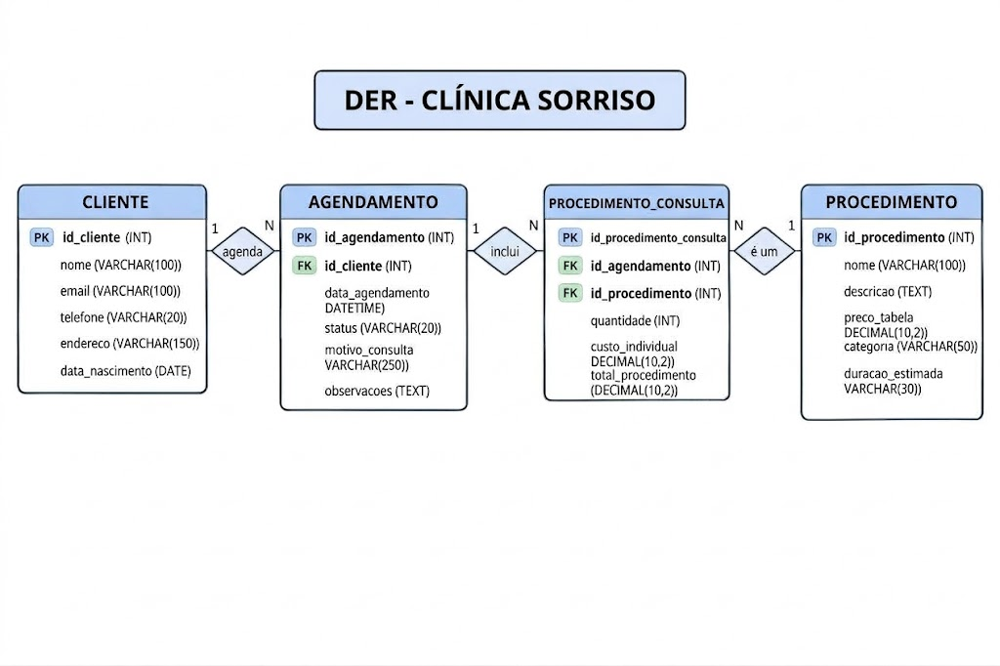

O objetivo é criar um sistema para o Dr. Roberto organizar os pacientes, os agendamentos e os atendimentos do consultório odontológico. O sistema permitirá cadastrar o nome completo e CPF do paciente, marcar consultas com os dentistas e registrar os procedimentos realizados e os dentes tratados.

A ideia é deixar a organização dos pacientes, consultas e prontuários mais simples e fácil de consultar. O sistema também deverá seguir as cores azul-marinho e prata, conforme solicitado.

## Diagrama DER

S